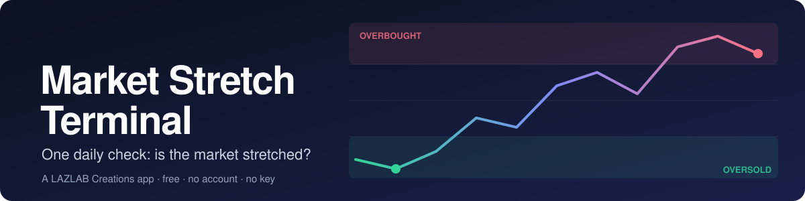
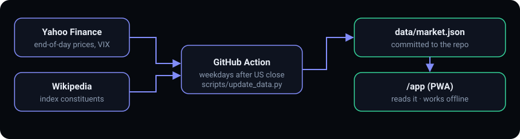

<p align="center"></p>

# Market Stretch Terminal

One daily check: is the market stretched? After each US close, Market Stretch Terminal reads the Nasdaq-100 (QQQM), S&P 500 (SPY) and Dow (DIA) and tells you in plain words whether each is stretched **down** (oversold, bounces get more likely) or **up** (overbought, pullbacks get more likely). Pick how sensitive you want it, glance at the answer, and get on with your day. Free, no account, no API key, installs like an app.

It reads where things stand. It does not predict.

## Live

| | URL |
|---|---|
| Landing page | https://johnlaz.github.io/mst/ |
| App | https://johnlaz.github.io/mst/app/ |

Install the app from its page: **Add to Home Screen** on iPhone, or the install icon in Chrome/Edge.

## Why you'll like it

- **One plain answer per index.** A status like *Leaning oversold* or *Neutral*, with the reason written out in a sentence.
- **Three sensitivity settings, not a pile of knobs.** Pullback (~8% drop), Correction (~13%) or Bear market (~25%). Pick one and every threshold follows.
- **Several signals, one verdict.** Momentum score, RSI, market fear (VIX) and distance from the peak, with a confluence check that shows how many agree.
- **Market internals.** Breadth (how many stocks are above their 50 and 200-day averages), new highs and lows, trading volume, and how long the signal has lasted.
- **Tap any stock for its chart.** 3 or 6 months of closing prices, a 50-day average, RSI, hover or touch readout, and a link out to the full Yahoo Finance chart.
- **See what happened after past signals.** A plain-language look back at what followed earlier oversold and overbought readings, so you know how much weight to give today's.
- **Your own pullback level.** Type a percentage and see where it sits against the market's history.
- **Built to be glanced at.** Clean glass-style cards, easy to read on a phone or tablet, works offline with the last data it saw.



## Repo layout

```
/
├── index.html              landing page (no manifest, no service worker)
├── README.md
├── docs/
│   ├── banner.svg          README banner
│   └── data-flow.svg       README visual
├── app/
│   ├── index.html          the whole app
│   ├── manifest.json
│   ├── sw.js               service worker (version must match the stamp in app/index.html)
│   ├── icon-192.png
│   ├── icon-512.png
│   └── apple-touch-icon.png
├── data/
│   ├── market.json         built by the Action; do not edit by hand
│   └── stocks.json         6 months of closing prices for the stock charts, same Action
├── scripts/
│   ├── update_data.py
│   └── requirements.txt
└── .github/workflows/
    └── update-data.yml     weekday evenings after the US close (3 attempts: 22:30, 23:30, 01:15 UTC)
```

`data/` stays at the repo root. The app loads `data/market.json` and falls back to `../data/market.json`, which is where the Action writes it. `stocks.json` (about 0.5 MB) is fetched only when you open a stock chart.

## Data sources

| Data | Source | Notes |
|---|---|---|
| Prices and volume | Yahoo Finance via `yfinance` | Keyless. End-of-day, rebuilt after each US close. |
| Index constituents | Wikipedia, then Nasdaq's public list | If both fail, the previous list is reused. |
| Backup for the three ETFs | Stooq, then Financial Modeling Prep (optional key) | Used only if Yahoo fails. |

Yahoo and Wikipedia are unofficial sources and can change without notice. Nasdaq-100 top-10 weight is approximate (market-cap share); S&P 500 weights are not computed.

## AI and model setup

None. The app does not use an AI provider.

## Data and privacy

- There is no server, account or database.
- Settings and any manual entries stay in your browser's local storage.
- An optional free FMP key, if you paste one into the app's Menu, is stored in your browser only and is never included in exports.

## Deploy and update

1. Settings → Pages → Source: Deploy from a branch → `main` / `/ (root)`.
2. Actions → "Update market data" → **Run workflow** (first run takes a few minutes and commits `data/market.json` and `data/stocks.json`).
3. If the run fails at the commit step: Settings → Actions → General → Workflow permissions → **Read and write permissions**.
4. To release an app change: edit `app/`, bump `VERSION` in `app/sw.js` **and** the version stamp in `app/index.html`, then push to `main`. Installed copies update on the next open.

Optional: repo secret `FMP_API_KEY`, used only as a last-resort backup source for the three index ETFs if Yahoo and Stooq both fail.

The sensitivity thresholds live in `PRESETS` near the top of the script in `app/index.html`. The "what followed past signals" table uses `PRESET_RULES` in `scripts/update_data.py`; keep the two in step.

## If something looks wrong

- Header says data is N days old: the Action failed or Yahoo blocked it that day. Check the Actions log and re-run.
- Site not updating after a successful run: confirm Pages is deploying from the branch the Action commits to.
- App looks stale after a release: reload once; the new service worker takes over on the next load.
- A stock chart says history appears after the next update: run the workflow once so `data/stocks.json` exists.
- Without `data/market.json` the app falls back to manual entry (Update data menu).

## Changelog

**v1.1.2**
- Menu has a contact box to email a note to yourself; copyright in the app footer.

**v1.1.1**
- Sensitivity toggle now stays put across tablet and phone sizes.
- Glass-style cards.

**v1.1.0**
- Tap any stock for a 3 or 6 month chart with 50-day average and RSI.
- The data update now retries failed tickers and handles stale Yahoo responses.

**v1.0.0**
- Landing page at the repo root, app moved to `/app`, installable PWA (manifest, service worker, icons), version stamp.

© 2026 LAZLAB Creations. All Rights Reserved. · lazlab.io@gmail.com
